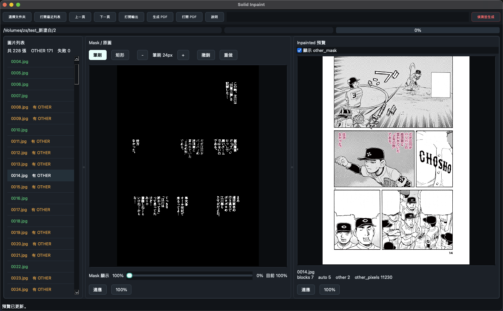

# Solid Inpaint

漫畫文字偵測、純色填充與精修輔助工具。

網站：[https://zsisme.github.io/comic-text-detector-inpaint/](https://zsisme.github.io/comic-text-detector-inpaint/)

Solid Inpaint 會先偵測漫畫圖片中的文字，對純色背景文字生成透明去字 overlay；對非純色背景、框外字、網點、線稿或複雜背景文字，保存為 OTHER 選區。明確導出 PSD 時，可用 LaMa 將 OTHER 區域修補成獨立透明圖層，再於 Photoshop 中檢查和精修；原有 JSX 與 `OTHER_CHANNEL` 動作流程也可繼續使用。



本項目從源碼運行，支援 macOS 和 Windows，暫不打包原生 App。

## 主要用途

```text
1. 批量偵測漫畫文字 mask
2. 自動處理可靠純色背景文字
3. 生成可疊加的透明去字 overlay
4. 標記非純色背景文字為 other_mask
5. 按需導出分層 PSD，將 OTHER 區域的 LaMa 修補結果放在獨立圖層
6. 保留原圖、純色填充和黑白 OTHER Mask PNG，方便繼續精修
7. 也可選用 Photoshop JSX 與 OTHER_CHANNEL 動作流程
```

一句話：

```text
不止是生成框外去字圖，而是轉換為可繼續精修的 Photoshop PSD。
```

## 快速開始

建議使用 Python 3.10-3.12。Python 3.13+ 可能可用，但不建議普通用戶首次安裝時使用。

macOS：

```text
雙擊 塗白.command
```

如果 macOS 提示命令文件不可執行，先執行一次：

```bash
chmod +x 塗白.command
```

Windows：

```text
雙擊 launch.bat
```

首次啟動會自動：

```text
1. 建立 .venv
2. 安裝 requirements.txt
3. 校驗 Koharu Layout HighRes（文字與氣泡）及 lama_large_512px（PSD 匯出修補）權重，缺失時下載
4. 啟動圖形界面
```

文字與氣泡偵測只使用 RF-DETR（Koharu Layout HighRes）。運算裝置可選自動、MPS、CPU 或 CUDA；自動模式依序使用可用的 CUDA、MPS 或 CPU。

## 手動啟動

macOS：

```bash
python3 bootstrap.py
```

Windows：

```bat
py -3 bootstrap.py
```

如果想手動管理依賴：

macOS：

```bash
python3 -m venv .venv
.venv/bin/python -m pip install -U pip
.venv/bin/python -m pip install -r requirements.txt
.venv/bin/python solid_inpaint_ui.py
```

Windows：

```bat
py -3 -m venv .venv
.venv\Scripts\python -m pip install -U pip
.venv\Scripts\python -m pip install -r requirements.txt
.venv\Scripts\python solid_inpaint_ui.py
```

`requirements.txt` 使用 `PySide6-Essentials`，避免安裝完整 `PySide6` 時下載大型 Qt Addons。

## 圖形界面功能

```text
選擇圖片資料夾
打開最近列表
偵測並生成
使用傳入 Mask 運行
顯示進度
瀏覽圖片列表
Mask / 原圖疊加預覽
手動編輯 mask
矩形、筆刷、魔法棒工具：配合「添加 / 減去」編輯目前 mask
套索工具：左鍵逐點建立多邊形，雙擊或 Enter 閉合並套用
套索支援添加、減去、局部交集、從其他轉入和選區 RF-DETR 偵測
局部視窗：矩形框選 ROI，在獨立放大視窗編輯副本；選擇頂部「調整邊框」工具後，可拖動上下左右四條邊界線，也可輸入 X、Y、寬、高；筆刷、矩形、套索和魔法棒的計算與 mask 修改都強制限制在邊框內，套用後才回寫主頁
右鍵拖曳矩形：清除範圍內所有 mask 層
撤銷 / 重做
編輯後自動保存 mask
自動重新生成當前頁預覽
Inpainted 合成預覽
可顯示 other_mask
導出右圖
導出待精修配對圖片
打開輸出資料夾
生成 PDF 預覽
打開 PDF 預覽
工作流比較與 Mask 分區合成
```

介面只保留 **F1 純色填充**、**F2 圖像修補**。首次偵測自動分配兩類；人工編輯後直接保存顏色與範圍，不會反覆重新分類。加入一類會移除另一類，擦除後保留原圖。重新偵測與重新分類會保留人工修改，包括擦除。

氣泡填充使用 Koharu Layout HighRes 的 `bubble` 實例輪廓，預設將內縮區直接塗白；取消「直接對氣泡塗白」時，只用氣泡內已判為純色文字的底色擴張。兩種模式均保留人工修改、擦除及重疊接縫。左側白色選區顯示實際填色範圍，轉為圖像修補時會搬移所選白區；既有頁面不會自動重跑。詳見 [氣泡填充](docs/mangalens_solid_fill.md)。

「使用傳入 Mask 運行」的取代模式以傳入 Mask 重新分類並保留人工決定；交集模式同時收窄兩類並保留填色顏色。沒有同名 PNG 的頁面保持原狀。

「從其他轉入」會搬移本次選區碰到的另一類既有選區，包含選中的氣泡填色範圍；框選過大可能連氣泡邊緣一起轉入，宜用套索或局部放大確認。它不能補出漏選的文字。

「導出待精修」按需生成 `ctd_inpainted/export_pair/` 的合成 PNG、`other_mask/` 與 `colored/`。「導出右圖」共用其中的 `colored/`。

完整操作和儲存格式見 [兩類專案說明](docs/two_class_project.md)。

使用 Codex 執行完整的 Computer Use 去字工作流時，可呼叫專案內的 [$comic-detect-review](.agents/skills/comic-detect-review/SKILL.md)，並提供圖片資料夾路徑，例如：「使用 $comic-detect-review，對指定資料夾開始偵測，再逐頁校正並保存。」此 Skill 包含漏選補正、誤判恢復、純色填充／待修復判斷與保存核對。

### AI 監修操作

可直接貼上圖片資料夾路徑開啟專案，並輸入頁碼或完整檔名跳頁。頂部獨立顯示目前頁面、保存狀態及編輯類型／工具／選區模式；偵測進度不代表正在校對的頁面。低頻導出與工作流功能位於「更多」。

跨顯示器監修時，先按「整理監修視窗」：依目前螢幕可用範圍，以一致的邏輯尺寸置中並重新適應兩側畫布。小螢幕會縮小到可用範圍內，不沿用另一台顯示器的螢幕座標；整理後重新取得畫面再框選。

「F3 恢復原圖」讓矩形或套索的左鍵選區同時清除純色填充和待修復標記，可撤銷；切換工具會保留仍相容的添加／減去模式。局部視窗顯示原圖座標與尺寸，修改副本必須按「套用」才保存。

逐頁確認後可按「標記已校對」或「完成本頁並到下一頁」。校對狀態跟專案保存，與 OTHER 分開計數；選區、顏色或人工擦除記錄改變後，該頁回到待回看。相同內容重存不會清掉校對標記。

### MCP 控制

可選的本機 MCP 介面提供開啟專案、全話偵測與範圍覆蓋核對、同版原圖／合成預覽，以及帶頁面 token 的矩形／多邊形編輯、單批撤銷和保存後校對標記。選區沿用 GUI 核心與正式保存，圖像語意、細字及修改結果仍逐頁視覺檢查；筆刷、魔法棒和局部副本可繼續使用 Computer Use。普通 GUI 啟動不需要安裝 MCP SDK；契約及接入方式見 [MCP 使用說明](docs/mcp.md)。

「工作流比較」會開啟獨立視窗。選擇一個 `export_pair` 文件夾後，工具會讀取根目錄底圖，並自動識別 `inpaint_workflows/` 內任意數量的工作流子文件夾；它會逐組比較工作流圖片與底圖來生成各自的差異 Mask，不再依賴 `other_mask/`。頂部可調整「差異閾值」、「最小區域」及「Mask 擴大」（預設 `5 px`），差異 Mask 會緩存在 `.workflow_compare/diff_masks/`，也可按「重算 Mask」刷新當頁。比較區最左側固定顯示當頁實際合成效果，右側可同步比較最多三組結果；所有圖片同步縮放和移動，每張工作流圖片頂部的原圖比較滑桿也會同步移動，初始值為 `0`，即完整顯示工作流結果。每個工作流名稱旁的色塊代表該工作流的 Mask 顏色；在對應面板中，已採用區域使用較高不透明度，未採用區域以相同顏色淡化顯示。首次載入的頁面預設採用第一組工作流；在工作流圖片上左鍵拖矩形或使用筆刷，可重新指定該工作流差異 Mask 內的局部來源，右鍵拖矩形則直接指定該範圍保留原圖，中鍵拖動用於平移。圖片下方按鈕可將該工作流的整個差異 Mask 指定給該組。`M` 顯示或隱藏選區，`[`、`]` 調整筆刷大小。選擇狀態保存在 `.workflow_compare/`，最終圖片和來源摘要 `selection.json` 輸出到 `result/`。

快捷鍵：

```text
B：筆刷
R：矩形
F3：恢復原圖（左鍵清除兩類選區）
[：縮小筆刷
]：放大筆刷
A / D：上一頁／下一頁（輸入欄位內不觸發）
方向鍵：移動畫布
Ctrl+Z：撤銷
Ctrl+Shift+Z：重做
```

## 無界面批量偵測

已安裝依賴及 HighRes 模型後，可直接對圖片資料夾執行偵測，不啟動 GUI，也不需要 MCP：

macOS：

```bash
.venv/bin/python detect_solid_inpaint_folder.py "/path/to/image_folder"
```

Windows：

```bat
.venv\Scripts\python detect_solid_inpaint_folder.py "D:\path\to\image_folder"
```

預設檢查整個資料夾，只偵測尚無結果或首次偵測失敗的頁面；已成功偵測的頁面（包括沒有選區的空白頁）及已有人工資料會保留。重複執行可以繼續未完成頁面，不會自動重跑已有結果。只做偵測，不標記為已逐頁校對。

依 GUI 相同的檔名自然排序，以從 1 開始的頁碼指定範圍，包含首尾：

```bash
.venv/bin/python detect_solid_inpaint_folder.py "/path/to/image_folder" --start-page 5 --end-page 8
```

確定要重跑已有結果時，明確加上 `--redetect`；只影響指定範圍，沿用核心流程保留人工修改及擦除：

```bash
.venv/bin/python detect_solid_inpaint_folder.py "/path/to/image_folder" --start-page 5 --end-page 8 --redetect
```

人工修改的保留適用於同一版原圖。原圖已更換時，明確重跑會按核心既有行為建立新頁，舊人工選區不會沿用；重跑前先核對來源及保留需要的舊成果。

可指定運算裝置及是否填充氣泡；模型固定為 HighRes，例如：

```bash
.venv/bin/python detect_solid_inpaint_folder.py "/path/to/image_folder" --detector rfdetr --device cpu --no-bubble
```

| 參數 | 用途 |
| --- | --- |
| `--detector` | 僅接受 `rfdetr`，可省略；使用 Koharu Layout HighRes |
| `--device` | `auto`、`cpu`、`mps` 或 `cuda`；未指定時沿用有效的專案參數，新專案預設自動 |
| `--bubble`／`--no-bubble` | 開啟／關閉氣泡填充；未指定時沿用專案設定，新專案使用預設值 |
| `--start-page`／`--end-page` | 從 1 開始、包含首尾的頁碼；省略結束頁時取最後一頁 |
| `--redetect` | 允許重新偵測選定範圍的已有結果 |

舊 v2 專案即使記錄了已移除的模型，仍可開啟和保留已保存結果。執行新偵測或重新分類時，改用 HighRes 安全預設，不沿用舊模型專屬參數；原本的 RF-DETR 參數可繼續沿用。明確指定已移除的模型名稱會回報參數錯誤。

命令列不讀寫 GUI 的全局偏好。結果保存為相同的 `ctd_inpainted/raw/` 專案資料，之後開 GUI 可直接繼續校正；不自動導出 PDF、PNG 或 PSD。終端會顯示偵測、跳過及失敗計數；退出碼 `0` 表示本次任務成功、`1` 表示有頁面失敗，`2` 表示參數或啟動錯誤。

若原圖已變更、正式頁面資料缺失或損壞，預設回報問題，不以重新偵測悄悄覆蓋。不要同時從 GUI 與 CLI 修改同一個漫畫資料夾，專案尚無跨程序編輯鎖。

## 輸出結構

輸入資料夾：

```text
/path/to/image_folder
```

輸出資料夾：

```text
/path/to/image_folder/ctd_inpainted
```

正式資料與可重建快取：

```text
ctd_inpainted/raw/project.json
ctd_inpainted/raw/pages/<原圖檔名>.npz
ctd_inpainted/raw/cache/<原圖檔名>.npz
```

每頁正式檔保存兩類選區、純色顏色和人工修改記錄；快取合併氣泡輪廓、背景取樣與診斷，不另存文字偵測選區。空白頁不產生空白 NPZ。
PDF、PNG 和 PSD 按需導出到 `raw` 之外，日常保存不產生多組重複 PNG，也不執行 LaMa 修補。

新版不相容舊格式。請將舊 `ctd_inpainted` 改名保留，再重新偵測建立新版專案；程式不會自動刪除旧成果。

## PSD 導出與 Photoshop 精修

在程式中按「導出 PSD 素材」。程式先保存目前編輯，再由背景工作分兩階段導出：

1. **LaMa 修補**：先完成本批全部頁面的 PNG 素材與透明修補 PNG。
2. **PSD 組裝**：全部修補 PNG 完成後，讀取原圖、`solid` 和修補 PNG 組成分層 PSD，不再執行模型推論。

視窗顯示整批進度條，以及目前階段、該階段頁碼與檔名；進度按頁更新，完成後顯示 PSD 所在路徑：

```text
<image folder>/ctd_inpainted/psd_assets/solid/<name>.png
<image folder>/ctd_inpainted/psd_assets/other_mask/<name>.png
<image folder>/ctd_inpainted/psd_assets/lama_large_512px/<name>.png
<image folder>/ctd_inpainted/psd_assets/psds/<name>.psd
```

`solid` 維持原有透明填色 PNG，`other_mask` 維持原有黑白 Mask PNG；`lama_large_512px` 保存原圖尺寸的 RGBA 透明修補 PNG，方便直接檢查或另行使用。新 PSD 由 `psd-tools==1.26.1` 直接產生，可在 Photoshop 開啟；圖層由上到下為：

| 圖層 | 內容 | 初始狀態 |
| --- | --- | --- |
| `lama_large_512px` | 從同名透明修補 PNG 讀入，內容為 LaMa 對原圖 `other_mask > 0` 區域的修補結果 | 隱藏 |
| `overlay-manual` | 保存的純色填充 overlay；Alpha 非零時才建立 | 顯示 |
| `bg` | 原圖背景 | 顯示 |

`lama_large_512px` 是普通 RGBA 圖層，與落盤的修補 PNG 使用同一份內容。LaMa 的 8-bit 修補輸出在修補區內 Alpha 為 255，區外的 RGBA 全為 0；它不是黑白 Mask 圖層。寫入 16-bit PSD 時，修補內容按 PSD 位深轉存，區內仍為完全不透明。OTHER 為空時仍輸出全透明修補 PNG，但不載入或執行 LaMa，PSD 可保留空透明修補層。新 PSD 不建立黑白 `other_mask` 圖層或 `OTHER_CHANNEL`，需要黑白選區時可使用旁邊的 `other_mask` PNG。

PSD 保留來源尺寸與位深，RGB 來源已有的 ICC 描述檔會直接寫入。8-bit CMYK 或帶灰階 ICC 的來源會先轉為 sRGB，並使用轉換後的 ICC；16-bit 灰階 ICC 或其他不能套用到 RGB PSD 的描述檔會明確回報錯誤。16-bit 原圖的背景仍保留 16-bit；LaMa 使用 8-bit 輸入與修補內容，不會因此把整張背景降為 8-bit。修補層預設隱藏，開啟 PSD 後可自行顯示並檢查修補品質。

LaMa 只在明確執行 PSD 導出時處理 OTHER 選區，不重新偵測、不重新分類，也不回寫原圖或 `raw/` 正式頁面資料。每次明確批次導出都按當次資料更新 PNG 素材與修補 PNG；已存在的同名 PSD 預設跳過，保留 Photoshop 中的手動修改。需要另一版 PSD 時，先保留或改名舊檔，再明確導出。

### 原有 Photoshop JSX 流程

`create_psds_from_outputs.jsx` 仍可選用。於 Photoshop 執行 `File > Scripts > Browse...` 選取腳本；它讀取上述 `solid/`、`other_mask/` PNG，輸出到另一個目錄：

```text
<image folder>/ctd_inpainted/psd/<name>.psd
```

此腳本維持原本的 `bg`、`overlay-manual` 與 `OTHER_CHANNEL` 流程。`OTHER_CHANNEL` 保存非純色背景文字的選區，可勾選「有 OTHER_CHANNEL 時執行動作」，選擇已錄好的 Photoshop 動作組和動作。它與程式直接產生的 `psd_assets/psds/` 是兩條分開的導出流程，不會替新 PSD 加入 LaMa 圖層。

## 模型文件

唯一的文字與氣泡偵測器是 RF-DETR（Koharu Layout HighRes）；PSD 導出另使用 LaMa 修補模型。目前兩個權重透過 Git LFS 納入版本控制。請先安裝 Git LFS；若已拉取但模型仍是指標檔，執行以下命令取得實體模型：

```bash
git lfs install
git lfs pull
```

`bootstrap.py` 仍會校驗以下權重，缺失時從原來源下載；已存在且校驗相符時不重複下載：

```text
models/koharu-layout-highres/model.safetensors
models/lama_large_512px.ckpt
```

HighRes 模型來源：[mayocream/koharu-layout-highres](https://huggingface.co/mayocream/koharu-layout-highres)。模型授權與歸屬屬於原項目。

HighRes 使用 `RFDETRSeg2XLarge`、1920 × 1920 輸入及最多 160 個偵測結果，類別為 `text`、`onomatopoeia`、`bubble`、`panel`。依官方設定，四類信心門檻分別為 0.25、0.30、0.50、0.40；預設只合併文字與狀聲詞的 Mask。下載、SHA-256 校驗、載入與推論設定集中於 `rfdetr_config.py`。建議使用 GPU。

「偵測並生成」和「添加偵測」均只顯示「RF-DETR（Koharu Layout HighRes）」，可設定運算裝置、Mask 膨脹尺寸與塗白範圍。設定會保存，下次開啟沿用；原先保存的其他模型選擇回退到 HighRes。矩形、套索等選區工具保留「添加RF-DETR選區」，使用上次保存的 RF-DETR 設定。

文字與氣泡共用 HighRes 權重：一般頁面共用一次推論，氣泡使用獨立的 `bubble` 實例遮罩（門檻 0.50），不受文字塗白類別、Mask 合併或膨脹設定影響。外部 Mask 需要氣泡填充時，才另外懶載入 HighRes 氣泡模型；長圖使用重疊裁窗並優先沿用已載入的偵測器。關閉氣泡填充不讀取氣泡快取，也不另外執行氣泡推論。

其他文字與氣泡偵測器的入口、下載設定及適配程式已移除。新氣泡快取包含模型雜湊、解析度、門檻及裁窗版本，與舊模型快取隔離；既有正式頁面與人工修改不會因模型更新而重新偵測。

PSD 匯出修補使用 [dreMaz/AnimeMangaInpainting 的 lama_large_512px.ckpt](https://huggingface.co/dreMaz/AnimeMangaInpainting/resolve/main/lama_large_512px.ckpt)，SHA-256 為 `11d30fbb3000fb2eceae318b75d9ced9229d99ae990a7f8b3ac35c8d31f2c935`。下載設定集中於 `lama_config.py`，推論由 `lama_inpainter.py` 按需執行；模型架構的 GPL 衍生來源與授權說明保留在 `vendor/lama_large.py` 及相關授權檔。LaMa 的修補效果需要人工確認，不代表 OTHER 分類或頁面校對已完成。

偵測器依賴包含 `rfdetr==1.7.0`、`transformers==5.15.0`、`supervision==0.28.0`；分層 PSD 導出使用 `psd-tools==1.26.1`。Python 3.10 的 Apple Silicon macOS 固定使用 `scipy==1.14.1`，避開在該環境無法載入的 1.15.3 wheel；其他環境由 pip 選擇相容版本。Python 3.13 以上使用 NumPy 2，較舊 Python 沿用 NumPy 1 的限制。舊模型專用套件不再列為直接依賴；PyTorch 等套件仍會安裝自身所需的間接依賴。

如果缺少 HighRes 權重，命令行和圖形界面都會提示找不到模型文件；PSD 導出遇到非空 OTHER 時也需要已校驗的 LaMa 權重。

## GitHub Pages

本倉庫的介紹頁放在：

```text
docs/index.html
```

啟用 GitHub Pages：

```text
1. 打開 GitHub 倉庫頁面
2. 進入 Settings
3. 左側選 Pages
4. Source 選 Deploy from a branch
5. Branch 選 main
6. Folder 選 /docs
7. Save
```

啟用後網址通常是：

```text
https://zsisme.github.io/comic-text-detector-inpaint/
```

如果 GitHub 顯示的 Pages 地址不同，以 GitHub Settings > Pages 中顯示的地址為準。

## 倉庫內容

需要保留在倉庫中的主要文件：

```text
README.md
requirements.txt
bootstrap.py
塗白.command
launch.bat
detect_solid_inpaint_folder.py
solid_inpaint_ui.py
create_psds_from_outputs.jsx
models/.gitkeep
rfdetr_config.py
load_model.py
rfdetr_detector.py
image_io.py
mask_utils.py
psd_export.py
lama_config.py
lama_inpainter.py
vendor/lama_large.py
docs/
icons/
vendor/LICENSE-BallonsTranslator
```

不要提交：

```text
.venv/
__pycache__/
.DS_Store
ctd_inpainted/
models/koharu-layout-highres/model.safetensors
models/lama_large_512px.ckpt
```

## 開發注意

- 氣泡填充與 LaMa 架構的衍生設計保留來源標註，相關授權正文見 `vendor/LICENSE-BallonsTranslator`；其他上游來源註記見對應模組。
- 建議用 Python 3.10-3.12 測試發佈流程。
- `requirements.txt` 依 Python 版本限制 NumPy：Python 3.13 之前使用 NumPy 1，Python 3.13 以上使用 NumPy 2。
- `inpainted` 是完整畫布尺寸的透明 PNG，不需要 Photoshop 圖層用的四角 anchor pixel。
- `other_mask` 表示不能自動純色填補、需要後續處理的 repair area。
- 每次調整純色判斷參數後，建議手動生成並查看 `preview_report.pdf`。
